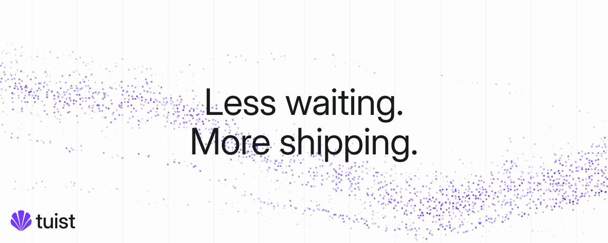

<picture>
  <source media="(prefers-color-scheme: dark)" srcset="./GitHub-Dark.png">
  <source media="(prefers-color-scheme: light)" srcset="./GitHub-Light.png">
  
</picture>

Tuist is a build platform for engineering teams and their coding agents. It works with Xcode, Gradle, Bazel, Elixir, and Rust builds, alongside the CI you already use. Features vary by toolchain: Rust compilation caching is experimental, and Once support is in canary.

- [🚝 **Cache**](https://tuist.dev/en/docs/guides/features/cache): Reuse build artifacts across machines and CI.
- [✅ **Selective testing**](https://tuist.dev/en/docs/guides/features/selective-testing): Skip test targets that haven't changed in Tuist-generated Xcode projects.
- [📦 **Registry**](https://tuist.dev/en/docs/guides/features/registry): Resolve [Swift Package Index](https://swiftpackageindex.com/) packages faster.
- [📈 **Build insights**](https://tuist.dev/en/docs/guides/features/build-insights): Track your projects, builds, and test runs, and find flaky tests.
- [📱 **Bundle insights**](https://tuist.dev/en/docs/guides/features/bundle-size): Analyze your built apps and find ways to shrink them.
- [📲 **Previews**](https://tuist.dev/en/docs/guides/features/previews): Share app builds with a link.
- [🗂️ **Generated projects**](https://tuist.dev/en/docs/guides/features/projects): Define Xcode projects in Swift and keep them easy to manage.
- [🤖 **Agentic coding**](https://tuist.dev/en/docs/guides/features/agentic-coding/mcp): Give coding agents your build and test data through an MCP server and agent skills.

Openness and community are cornerstones in shaping Tuist, as we believe they are the key to building the best solution. We recommend checking out the following resources:

- [📑 **Documentation**](https://tuist.dev/en/docs)
- [📚 **Handbook**](https://handbook.tuist.dev)
- [💬 **Community forum**](https://community.tuist.dev)
